# Agentic System

This project introduces a **LangGraph-driven agentic system** that automatically categorizes anomalies in industrial telemetry data (such as a Multistage Centrifugal Water Pump) and triggers downstream actions. Powered by a central LLM at the classifier node, the agent provides **failure modes, root-cause analyses, and recommended actions** across three action tiers:

* **Class 0 (Immediate Shutdown):** Critical threats or catastrophic failures.
* **Class 1 (Automated Control Adjust):** Moderate, single-metric drift managed via automated control.
* **Class 2 (Field Engineer Dispatch):** High-severity mechanical degradation or multi-metric anomaly combinations.

**Key Technical Approach**

1. **Target Telemetry:** Monitored across four variables—Temperature (`temperature_c`), Vibration (`vibration_hz`), Pressure (`pressure_psi`), and Power (`power_kw`).
2. **Deterministic Pre-Processing Over Raw Stats:** Instead of forcing the LLM to interpret raw numbers or statistical deviations (which risks hallucination due to non-linear severity curves), a dedicated tool maps values directly to document-backed severity bands (`Critically_Low` to `Critically_High`).
3. **Streamlined Architecture:** Replaces heavy RAG pipelines with targeted threshold lookup tools to give the LLM unambiguous domain context for reliable classification (Each Telemetry mapped to '`Critically_Low`, `Low`, `Normal`, `High` or `Critically_High`, based on clear threshold defined for each asset).


__[PDF Report](./report/Agentic_AI_System_Design_Report.pdf)__

## How to run the project
- GitHub Link: https://github.com/umscai/zc06-agentic-ai-sys
- The project __tested__ with Python version `3.13.14`, and __recommended__ to use python version `3.13 or above`
- We used uv for easier and faster package management and virtual environment setting.

1. __Clone__ the repo using the above link (if you have access), or unzip the provided compressed file.
2. __Install__ dependencies using `uv add -r requirements.txt` (or `pip install -r requirements.txt` without uv)
4. __IMPORTANT-1__: run  `uv pip install -e .`, to avoid path resolution especially for `.env` file
5. __IMPORTANT-2__: This project depends on the parameters in .env located on the project root folder
    - See instruction and required parameters in sample `.env` file: [sample.env](./sample.env), Updating `OPENAI_API_KEY` is __mandatory__, but other parameters are already set with intended values.
6. __Run__: `uv run agentic_system.py --asset 3 --test 1 --sample 2`
7. __Expected Results__:

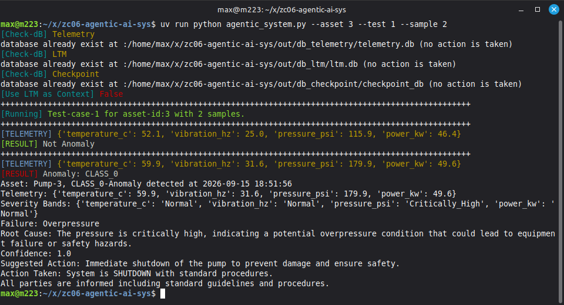


8. __Script Help__: `uv run agentic_system.py -h` or `uv run agentic_system.py --help`
```console
max@m223:~/x/zc06-agentic-ai-sys$ uv run python agentic_system.py -h
usage: agentic_system.py [-h] [-v] [-f {jsonl,txt}] [-a {1,2,3}] [-t {1,2,3,4}] [-s SAMPLES]

Arg Parser

options:
  -h, --help            show this help message and exit
  -v, --verbose         Enable verbose output (pretty-print logs to console)
  -f, --format {jsonl,txt}
                        The storage format for the logs
  -a, --asset {1,2,3}   asset-id/index to get normal operational parameters,...(default: 1)
  -t, --test {1,2,3,4}  Test-Case number (default: 1)
  -s, --samples SAMPLES
                        Number of telemetry samples to generate and inject to system(default: 1)
max@m223:~/x/zc06-agentic-ai-sys$
```
More details
- asset is the equipment id/index, currently 1,2,3
- test is the test-case number currently 1,2,3,4 (There are anomaly in case 1,2,3, but 4 is a place holder for extension, and currently is not anomaly)
- number of samples is number of samples to generate between start and end values in the test case
- test-case values (start and end, and the asset info) are saved in [test_case_and_asset_info.csv](./data/test_case_and_asset_info.csv)

9. __Note__: We have one env variable in `.env` (see `sample.env`) called `USE_CONTEXT=1` to use Long-Term-Memory (LTM) anomaly history of the asset, we can manually set to zero to not using LTM and see agent response. We have `use_ltm.sh` linux bash script to change this variable instead of manually change it, just for easier test purpose as follow:
```console
# Set USE_CONTEXT=1 from command-line, then run agentic_system.py
max@m223:~/x/zc06-agentic-ai-sys$ ./use_ltm.sh 1; uv run agentic_system.py --asset 1 --test 1 --sample 2

# Set USE_CONTEXT=0 from command-line, then run agentic_system.py
max@m223:~/x/zc06-agentic-ai-sys$ ./use_ltm.sh 0; uv run agentic_system.py --asset 1 --test 1 --sample 2
```


## Folder and File Structure
Project folder and file structures are shown below, where `agentic_system.py` is main script, and all supporting functions collected `src`, and `out` folder will be generated with shown structures for 3 used databases and the log files while `data` folder is devoted to asset and test-case info, and `report` folder contains report related files, while pdf report will be in details, result are also collected in the a `test_result.ipynb` under `notebook` folder for quick review.

```console
├max@m223:~/x/tmp/zc06test$ tree -L 3
.
├── agentic_system.py
├── data
│   ├── test_case_and_asset_info_colored.xlsx
│   └── test_case_and_asset_info.csv
├── LICENSE
├── main.py
├── minimal_req.ini
├── notebook
│   └── test_result.ipynb
├── out
│   ├── db_checkpoint
│   │   └── checkpoint_db
│   ├── db_ltm
│   │   └── ltm.db
│   ├── db_telemetry
│   │   └── telemetry.db
│   └── logs
│       └── log.jsonl
├── README.md
├── report
│   ├── latex
│   │   └── img
│   ├── Agentic_AI_System_Design_Report.pdf
│   └── test_result.html
├── requirements.txt
├── sample.env
├── src
│   ├── agents
│   │   ├── agent_anomaly_detector.py
│   │   ├── agent_class0_shutdown.py
│   │   ├── agent_class1_control.py
│   │   ├── agent_class2_escalate.py
│   │   ├── agent_classifier.py
│   │   ├── agent_common.py
│   │   ├── agent_ltm_update.py
│   │   └── __init__.py
│   ├── config.py
│   ├── db_model
│   │   ├── ltm_model.py
│   │   └── telemetry_model.py
│   ├── orchestration
│   │   ├── assistant.py
│   │   ├── graph.py
│   │   └── __init__.py
│   ├── tools
│   │   ├── anomaly_detector_tool.py
│   │   ├── checkpoint_db_analytics.py
│   │   ├── __init__.py
│   │   ├── ltm_db_tools.py
│   │   ├── severity_bands_tools.py
│   │   └── telemetry_db_tools.py
│   └── utils.py
└── use_ltm.sh
```

# Normal and Anomaly Region
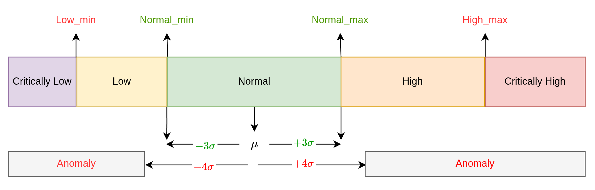

# Workflow Graph
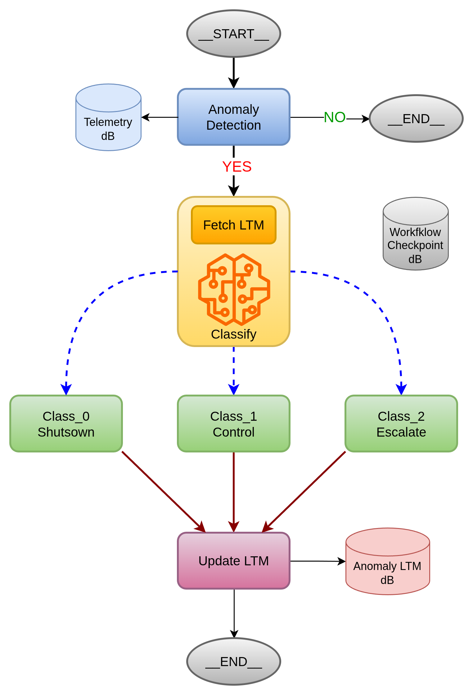


# Sample Results CLASS_0
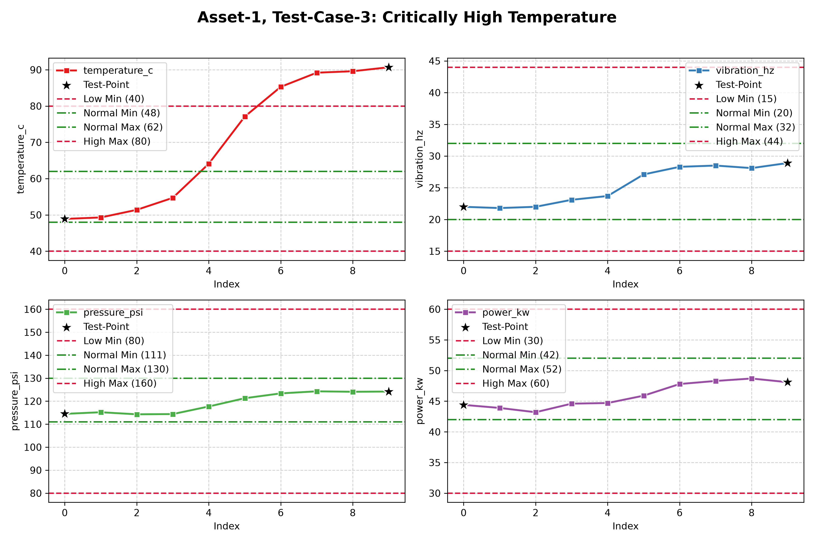

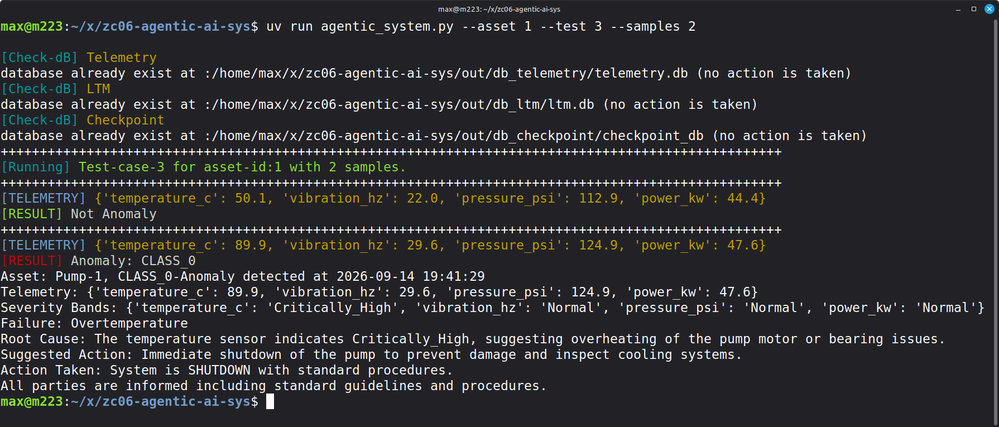


# Sample Results CLASS_1
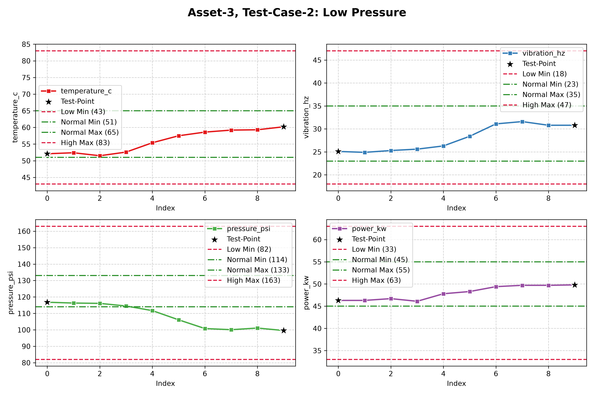

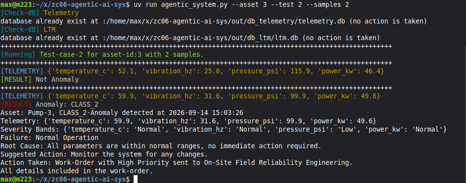


# Sample Results CLASS_2
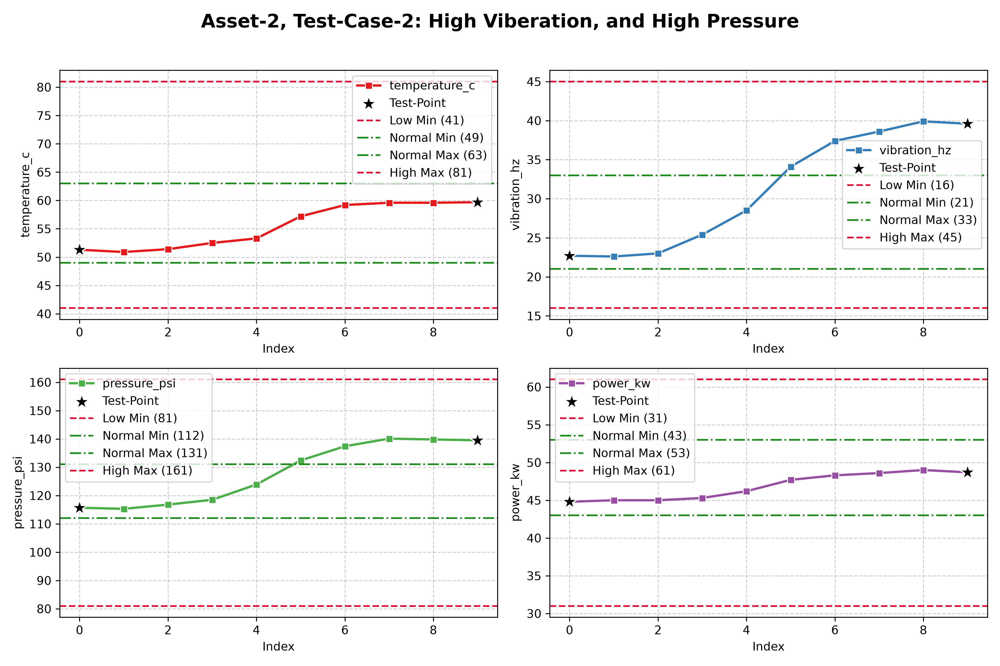

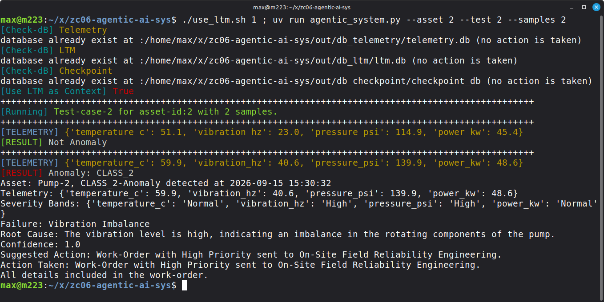


# Analytics
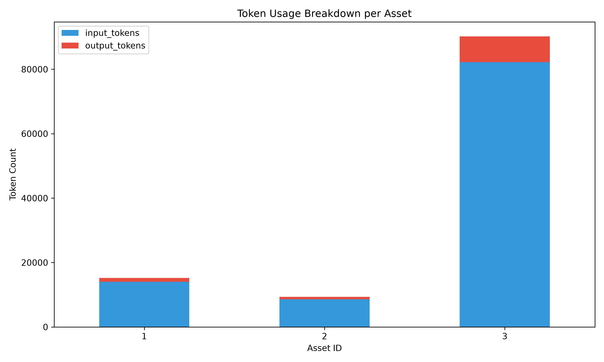

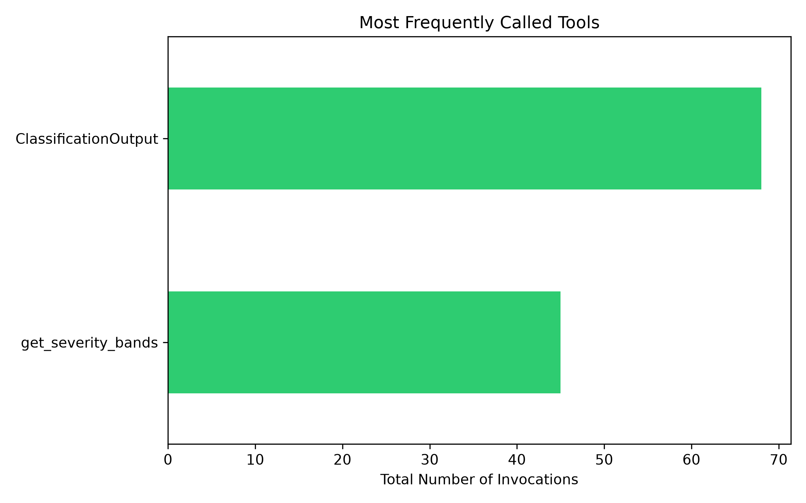

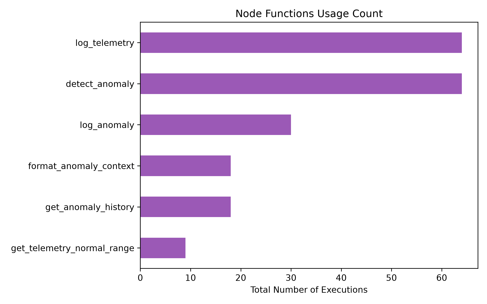


